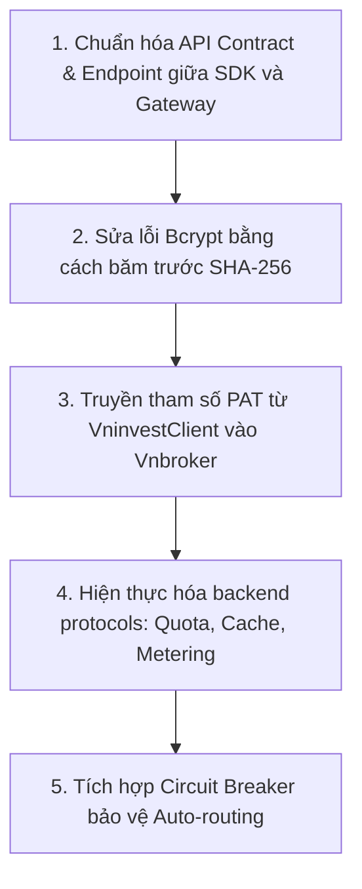

# Vninvest SDK - Architecture Documentation

## Dual-Mode: Gateway (SaaS) + Direct (Local Providers) — Unified by PAT

---

## 1. Overview

> **Lưu ý quan trọng**: Thiết kế kiến trúc này dựa trên repo `vnbroker` (core library) và `vninvest-sdk` (SDK wrapper PAT-based). Vui lòng xem `README.md` mới nhất để cập nhật trạng thái triển khai thực tế.

**vnbroker** cung cấp một lớp truy cập dữ liệu thống nhất, đa nguồn, cho thị trường chứng khoán Việt Nam và quốc tế. Từ v2.0.0 trở đi, **tất cả truy cập dữ liệu phải sử dụng Vnbroker với PAT hợp lệ**.

| Chế độ | Mô tả | Use Case | PAT Required |
|--------|-------|----------|-------------|
| **Gateway Mode** | Gọi Core API (vninvest SaaS backend) qua HTTP | Production, multi-tenant, billing, quota | ✅ Bắt buộc |
| **Direct Mode** | Gọi trực tiếp providers (VCI, KBS, TCBS, DNSE, MSN, FMP) qua vnbroker | Giảm tải Gateway, tránh rate-limit provider | ✅ Bắt buộc (License) |

> **⚠️ THAY ĐỔI QUAN TRỌNG từ v2.0.0**: Tất cả direct access APIs (`Quote()`, `Company()`, ...) đã bị **deprecated** và sẽ bị loại bỏ trong v2.0.0. **Bắt buộc phải dùng `Vnbroker(pat_key='...')`** để truy cập dữ liệu.

### Design Principles

1. **PAT as License Key**: Mọi user phải có PAT token hợp lệ mới sử dụng được thư viện (từ v2.0.0)
2. **Usage Tracking for Billing**: Mọi request đều được track (metering)
3. **Load Reduction**: Direct Mode bypass Gateway để tránh rate-limit nhưng vẫn qua thư viện để quản lý
4. **Provider Fallback**: AUTO mode tự động failover khi provider primary lỗi

---

## 2. Gateway Mode (vninvest SaaS)

### Kiến trúc
```
                                    ┌─────────────────────────────────────────────────────┐
                                    │            NGINX (Port 80)                        │
                                    │  Proxy: /api/* → Core API (8001)              │
                                    │  Serve: Frontend HTML/JS                 │
User App → VninvestClient ────────────┤                                     │
              │                     │  Direct: /core/v1/* → Core API     │
              │                     └─────────────────────────────────────────────────────┘
              │                                    ▲
              │         ┌───────────────────────────────────────────┤
              ▼         │      Core API (Port 8001)           │
     GatewayHttpClient ──────────│                                │
              │         │  /core/v1/market/quote/*      │
              │         │  /core/v1/market/company/*     │
              │         │  /core/v1/market/finance/*    │
              │         │  /core/v1/market/news/*      │
              │         │  /core/v1/market/snapshot/* │
              │         │  /core/v1/market/listing/*  │
              │         └───────────────────────────────────────────┤
              │                                    │
    ┌───────────┴───────────┐                  ▼
    │                 │        ┌───────────────────────────────────────────┐
    │  PAT Token Auth │        │  Providers                    │
    │  Quota Check  │────────│  (VCI, KBS, TCBS, DNSE, MSN, FMP)
    │  Cache Layer │        └───────────────────────────────────────────┘
    │  Metering    │
    │  Billing    │
    └─────────────┘
```

### Luồng Request
1. `client = VninvestClient(pat_key="vninvest_pat_...")` với `gateway_url`
2. `__init__`: Validate PAT format (sync), khởi tạo `GatewayHttpClient(base_url, pat_key)`
3. `_initialize()`: Gọi `auth.resolve_tenant(pat)` → lấy `TenantContext` (tier, scopes, allowed_symbols)
4. `client.quote(QuoteRequest(...))`:
   - Check scope `quote:read`
   - Check quota (Redis)
   - Check cache (Redis)
   - **Cache miss** → `GatewayHttpClient.post("/core/v1/market/quote/history", json=...)`
   - Core API route → Provider (AUTO: VCI-first → KBS fallback)
   - Response → Cache → Return user
   - Record metering (latency, cache_hit, provider)

### Core API Endpoints (OpenAPI)

**Swagger UI**: `http://localhost:8001/core/v1/schema/swagger-ui/`
**OpenAPI Schema**: `http://localhost:8001/core/v1/schema/`

| SDK Method | Core API Endpoint | HTTP Method | Description |
|------------|-------------------|-------------|-------------|
| `quote_history()` | `/core/v1/market/quote/history` | POST | Historical OHLC quotes |
| `quote_intraday()` | `/core/v1/market/quote/intraday` | POST | Intraday minute data |
| `quote_depth()` | `/core/v1/market/quote/depth` | POST | Price depth (order book) |
| `company_overview()` | `/core/v1/market/company/overview` | POST | Company overview |
| `company_profile()` | `/core/v1/market/company/profile` | POST | Company profile |
| `company_shareholders()` | `/core/v1/market/company/shareholders` | POST | Major shareholders |
| `company_insiders()` | `/core/v1/market/company/insiders` | POST | Insider trading |
| `company_subsidiaries()` | `/core/v1/market/company/subsidiaries` | POST | Subsidiaries |
| `company_officers()` | `/core/v1/market/company/officers` | POST | Board of directors |
| `company_events()` | `/core/v1/market/company/events` | POST | Corporate events |
| `finance_report()` | `/core/v1/market/finance/report` | POST | Financial statements |
| `news_latest()` | `/core/v1/market/news/latest` | POST | Latest news |
| `news_search()` | `/core/v1/market/news/search` | POST | News search |
| `snapshot_heatmap()` | `/core/v1/market/snapshot/heatmap` | POST | Market heatmap |
| `snapshot_price_board()` | `/core/v1/market/snapshot/price-board` | POST | Price board |
| `listing_symbols()` | `/core/v1/market/listing/symbols` | GET | Listing symbols |
| `listing_groups()` | `/core/v1/market/listing/groups` | GET | Industry groups |
| `health_check()` | `/core/v1/market/health` | GET | Health check |

### Config Environment Variables
```bash
# Core Settings
VNINVEST_API_KEY=vninvest_pat_xxxxxxxxxxxx          # PAT Key (bắt buộc)
VNINVEST_GATEWAY_URL=http://localhost:8001         # Core API URL
VNINVEST_GATEWAY_TIMEOUT=30
VNINVEST_GATEWAY_RETRIES=3

# Hoặc dùng VNBROKER_* aliases (vninvest-sdk tương thích)
VNBROKER_PAT_KEY=vninvest_pat_xxxxxxxxxxxx
VNBROKER_GATEWAY_URL=http://localhost:8001
```

---

## 3. Direct Mode (vnbroker Local — Bypass Gateway)

### Design Rationale

Direct Mode được thiết kế để:
- **Giảm tải Gateway**: Tránh route mọi request qua central server
- **Tránh rate-limit provider**: Khi nhiều user gọi cùng provider, tránh bị provider rate-limit
- **Vẫn qua thư viện**: Đảm bảo PAT validation và usage tracking cho billing

> **Quan trọng**: Direct Mode **vẫn yêu cầu PAT** để license. Chỉ bypass Gateway ở layer routing. Usage vẫn được track local và có thể report lên billing system.

### Kiến trúc & Data Flow
```
┌─────────────────────────────────────────────────────────────────────┐
│  User App → VninvestClient(pat_key="valid_pat")                      │
│                                                             │       │
│  ┌─────────────────────────────────────────────────────────┐ │       │
│  │ Step 1: Validate PAT format (sync)                      │ │       │
│  │   - Check prefix "vninvest_pat_"                        │ │       │
│  │   - Validate checksum (nếu có)                       │ │       │
│  └─────────────────────────────────────────────────────────┘ │       │
│                              │                               │       │
│  ┌────────────────────────────────────────────────────��────┐ │       │
│  │ Step 2: Resolve TenantContext (async/cached)           │ │       │
│  │   - Load scopes, tier, allowed_symbols                 │ │       │
│  │   - Cache TTL: 300s                                   │ │       │
│  └─────────────────────────────────────────────────────────┘ │       │
│                              │                               │       │
│  ┌─────────────────────────────────────────────────────────┐ │       │
│  │ Step 3: Check quota & scopes                          │ │       │
│  │   - require_scope("quote:read")                       │ │       │
│  │   - check_quota(tenant_id, "quote", cost=1)          │ │       │
│  └─────────────────────────────────────────────────────────┘ │       │
│                              │                               │       │
│  ┌─────────────────────────────────────────────────────────┐ │       │
│  │ Step 4: Check cache (Redis/Memory)                   │ │       │
│  │   - Key: "quote:{symbol}:{interval}:{from}:{to}"     │ │       │
│  │   - TTL: 300s                                        │ │       │
│  └─────────────────────┬───────────────────────────────┘ │       │
│                        │                                   │       │
└────────────────────────┼───────────────────────────────────┘       │
                         │ Cache HIT                          │       │
                         │ (return cached response)           │       │
                         │                                    ▼       │
                    ┌────┴────┐        ┌─────────────────────────────────┐
                    │ Cache   │        │  vnbroker → Providers           │
                    │ MISS    │───────▶│                                 │
                    └─────────┘        │  ┌─────────────────────────┐   │
                                       │  │ Provider Routing (AUTO) │   │
                                       │  │  1. Try VCI (primary)   │   │
                                       │  │  2. If error → KBS      │   │
                                       │  │  3. If error → TCBS    │   │
                                       │  └─────────────────────────┘   │
                                       └───────────────┬─────────────────┘
                                                       │
                        ┌─────────────────────────────┴─────────────┐
                        │                                         │
                        ▼                                         ▼
┌──────────────────────────────┐        ┌────���─��───────────────────────┐
│ Local Metering (batch)       │        │ Response to User            │
│                              │        │                              │
│ - Log: tenant_id, method,    │        │ - Parse & validate response  │
│   provider, latency, status  │        │ - Return QuoteResponse      │
│ - Batch: 100 events / 30s  │        └──────────────────────────────┘
│ - Webhook POST /billing     │
└──────────────────────────────┘
```

### Luồng Request
1. `client = VninvestClient(pat_key="vninvest_pat_...")` với `gateway_url=None` hoặc không truyền
2. `__init__`: Validate PAT format (sync), khởi tạo `Vnbroker(source="AUTO")`
3. `_initialize()`: Resolve TenantContext (local validation hoặc cache)
4. `client.quote(QuoteRequest(...))`:
   - Check scope `quote:read`
   - Check quota (local Redis/Memory)
   - Check cache (local Redis/Memory)
   - **Cache miss** → `vnbroker.stock(symbol, source).quote.history(...)`
   - Provider routing: AUTO (VCI-first → KBS fallback) hoặc explicit source
   - Response → Cache → Return user
   - **Record metering** (local, batch → billing webhook)

### Provider Routing (AUTO Mode)

| Data Type | Primary | Fallback | Use Case |
|-----------|--------|----------|----------|
| Quote/History | KBS | VCI | Historical OHLC (**KBS: 100%, ~0.5s**) |
| Quote/Intraday | KBS | VCI | Real-time minute data |
| Quote/Depth | KBS | VCI | Order book |
| Company/Overview | KBS | VCI | Company info (**KBS: 50%, VCI: 0%**) |
| Company/Finance | KBS | VCI | Financial statements (**KBS: 100%, ~0.5s**) |
| Company/Insiders | TCBS | - | Insider trading (requires auth) |
| Trading/Price Board | KBS | TCBS | Live trading (**needs fixes**) |
| Listing | KBS | TCBS | Symbols list (**KBS: 100%, 4784 rows**) |
| Private Brokerage | TCBS | DNSE | Direct trading API (**needs fixes**) |
| Screener | KBS | VCI | Stock screener (**KBS/VCI: 100%**) |
| News | - | - | **NOT IMPLEMENTED** - All providers fail |

### Provider Details

| Provider | Auth Required | Direct API | Rate Limit | Capabilities | Benchmark Status |
|----------|-------------|----------|------------|-------------|-----------------|
| **KBS** | ❌ Public | Direct | ~60 req/min | Quote, Company, Finance, Trading, Listing, Screener | ✅ **BEST - 100% success** |
| **VCI** | ❌ Public | Direct | ~100 req/min | Quote, Company, Finance, Listing, Screener | ⚠️ Financial 100%, Quote 50% |
| **TCBS** | ❌ Public | Direct | ~50 req/min | Quote, Company, Finance, Trading, Broker, Listing | ⚠️ Listing 100%, others need auth |
| **DNSE** | ✅ API Key+Secret | Direct | ~30 req/min | Quote, Listing, Broker | ❌ Missing credentials |
| **MSN** | ❌ Public | Direct | ~100 req/min | Quote, Listing, FX, Crypto, Index | ❌ Parameter mismatch |
| **FMP** | ✅ API Key | Direct | Varies | Quote, Listing, FX, Crypto, Index | ❌ No API key configured |

### Billing & Metering Flow

```
Per Request:
┌──────────────┐    ┌──────────────┐    ┌──────────────┐
│  API Call    │───▶│  Success    │───▶│  Log Event  │
│              │    │  / Failure │    │  (local)   │
└──────────────┘    └──────────────┘    └──────────────┘
                                            │
Periodically (every 30s):                   ▼
┌──────────────┐    ┌──────────────┐    ┌────────���─��───┐
│  Flush Batch │───▶│  Webhook POST│───▶│  Billing   │
│  (100 events)│    │  /billing   │    │  Service  │
└──────────────┘    └──────────────┘    └──────────────┘

Fallback khi billing unavailable: Local queue → Retry on restart
```

### Config Environment Variables
```bash
# Direct Mode (không cần Gateway URL)
VNINVEST_API_KEY=vninvest_pat_xxxxxxxxxxxx    # PAT bắt buộc (vẫn cần)
VNINVEST_GATEWAY_URL=                       # Để trống hoặc không set

# vnbroker Settings
VNINVEST_VNBROKER_SOURCE=AUTO                # AUTO, VCI, KBS, TCBS, DNSE, MSN, FMP
VNINVEST_VNBROKER_TIMEOUT=30

# Redis (Optional - fallback to memory nếu không có)
VNINVEST_REDIS_URL=redis://localhost:6379/0

# Billing (Optional)
VNINVEST_BILLING_WEBHOOK_URL=https://billing.example.com/webhook
VNINVEST_BILLING_WEBHOOK_SECRET=hmac_secret
VNINVEST_METERING_FLUSH_INTERVAL=30         # seconds
```

---

## 4. Dual-Mode Switching

### Runtime Decision (trong VninvestClient)
```python
class VninvestClient:
    def __init__(self, api_key: str, *, gateway_enabled: bool = None, ...):
        settings = get_settings()
        self._gateway_enabled = gateway_enabled if gateway_enabled is not None else settings.gateway.enabled
        
        if self._gateway_enabled:
            self._gateway = GatewayHttpClient(
                base_url=settings.gateway.base_url,
                pat_key=settings.gateway.pat_key or api_key,
                timeout=settings.gateway.timeout,
                retries=settings.gateway.retries,
            )
            self._broker = None
        else:
            self._gateway = None
            self._broker = Vnbroker(source=settings.vnbroker.default_source)
    
    async def quote(self, request: QuoteRequest) -> QuoteResponse:
        await self._initialize()
        self._require_scope(PATScope.QUOTE_READ)
        
        if self._gateway_enabled:
            return await self._quote_via_gateway(request)
        else:
            return await self._quote_via_direct(request)
```

### So sánh chi tiết

| Yếu tố | Gateway Mode | Direct Mode |
|--------|--------------|-------------|
| **Authentication** | PAT → Core API (Bearer) | PAT → Auth Service → TenantContext |
| **Quota** | Centralized (Core API) | Local (Redis/Memory) |
| **Cache** | Centralized (Core API) | Local (Redis/Memory) |
| **Metering/Billing** | Automatic (Core API) | Local (self-hosted) |
| **Provider Access** | All (VCI, KBS, TCBS, DNSE, MSN, FMP) | All (same) |
| **Private Brokerage** | Via Core API `/trading/*` | Direct TCBS/DNSE API |
| **Latency** | +Network hop (Core API) | Direct to provider |
| **Reliability** | Core API HA, fallback | Self-managed fallback |
| **Cost** | SaaS subscription | Self-hosted infrastructure |

---

## 5. PAT Validation & Security

### PAT as License Key — Always Required

**Quan trọng**: Cả hai chế độ đều **yêu cầu PAT token hợp lệ**. PAT được dùng để:
1. **License**: Xác nhận user có quyền sử dụng thư viện
2. **Tenant Identity**: Xác định tenant ID cho quota và metering
3. **Scope Check**: Kiểm tra quyền truy cập (quote:read, company:read, etc.)
4. **Billing**: Track usage theo tenant để tính phí

### Validate Points
```python
# 1. Format validation (sync, ngay trong __init__)
if not api_key.startswith("vninvest_pat_"):
    raise AuthenticationError("Invalid PAT format")

# 2. Auth service validation (async, trong _initialize)
self.context = await self._auth.resolve_tenant(api_key)
# → Verify PAT signature, expiry, tenant status
# → Load scopes, tier, allowed_symbols

# 3. Scope check (mỗi API call)
self._require_scope(PATScope.QUOTE_READ)

# 4. Symbol authorization
self.context.require_symbol_allowed(request.symbol)
```

### PAT Token Format

```
vninvest_pat_<prefix>_<random_string>
  └── Prefix: 22 ký tự (index lookup)
      └── Random: Đủ dài cho entropy

Examples:
- vninvest_pat_dev_free_default_unregistered_key  (Dev default)
- vninvest_pat_abc123xyz456789...                (Production)
```

### Security Boundaries

| Component | Gateway Mode | Direct Mode |
|-----------|-------------|-------------|
| **PAT passed to** | Gateway (Bearer token) | Library only (local validation) |
| **Credentials to providers** | Gateway manages | Library manages (direct) |
| **Billing data** | Real-time | Batch (webhook) |
| **Broker lane** | Via Core API | Direct TCBS/DNSE API |

### Security Best Practices

#### PAT Token Storage
```python
# ❌ KHÔNG NÊN: Store PAT in plain text
pat_key = "vninvest_pat_..."

# ✅ NÊN: Use environment variables
pat_key = os.getenv("VNINVEST_API_KEY")

# ✅ HOẶC: Use keyring for additional security
import keyring
pat_key = keyring.get_password("vninvest-sdk", "pat_key")
```

#### Scope Limitation
```python
# PAT tokens nên được giới hạn scope
# Ví dụ: Token chỉ cho phép đọc dữ liệu, không cho phép giao dịch
class PATScope:
    QUOTE_READ = "quote:read"
    COMPANY_READ = "company:read"
    FINANCE_READ = "finance:read"
    NEWS_READ = "news:read"
    TRADING_WRITE = "trading:write"  # Chỉ cho broker lane

# Kiểm tra scope trước mỗi request
def _require_scope(self, required_scope: str):
    if required_scope not in self.context.scopes:
        raise ScopeDeniedError(f"PAT không có scope: {required_scope}")
```

#### Encryption at Rest
```python
# Nếu cần cache PAT (không khuyến khích):
from cryptography.fernet import Fernet

# Mã hóa PAT trước khi lưu vào cache/redis
encrypted_pat = fernet.encrypt(pat_key.encode())
```

#### API Rate Limiting per Tenant
```python
# Giới hạn request rate per tenant để tránh abuse
class RateLimiter:
    def check_rate_limit(self, tenant_id: str, endpoint: str) -> bool:
        """Kiểm tra tenant không vượt quá rate limit."""
        # Allow 100 requests/minute/tenant/endpoint
        key = f"rate_limit:{tenant_id}:{endpoint}"
        ...
```

---

## 6. Error Handling & Provider Fallback

### Error Types

| Error Type | Gateway Mode | Direct Mode | HTTP Status |
|------------|--------------|-------------|-------------|
| **Auth Failed** | `AuthenticationError` | `AuthenticationError` | 401 |
| **Scope Denied** | `ScopeDeniedError` | `ScopeDeniedError` | 403 |
| **Quota Exceeded** | `QuotaExceededError` | `QuotaExceededError` | 429 |
| **Provider Error** | `ProviderError` | `ProviderError` | 502/503 |
| **Network Error** | `GatewayConnectionError` | `ProviderConnectionError` | - |
| **Validation Error** | `ValidationError` | `ValidationError` | 400 |
| **Provider Unavailable** | - | Circuit open | - |

### Retry Logic

**Gateway Mode**:
- Exponential backoff với config: `retries`, `timeout`
- Tối đa 3 retries trước khi báo lỗi

**Direct Mode (Provider Fallback)**:
```
Request → VCI (primary)
├── Success → Return response
├── Rate Limit (429) → Retry after cooldown → Fallback to KBS
├── Timeout (5s) → Fallback to KBS
├── Error (5xx) → Fallback to KBS
│
└── KBS (fallback)
    ├── Success → Return response
    ├── Rate Limit → Fallback to TCBS
    ├── Timeout → Return error (all providers failed)
    │
    └── TCBS (last resort)
        └── Success / Error → Return
```

### Circuit Breaker (AUTO Mode)

```python
class ProviderCircuitBreaker:
    """Prevent cascade failures when provider is unhealthy."""
    
    # Configuration
    failure_threshold = 5      # Open circuit after 5 consecutive failures
    success_threshold = 3      # Close circuit after 3 successes
    cooldown_period = 60       # Seconds before retry
    
    # States: CLOSED → OPEN → HALF_OPEN
    def allow_request(self, provider: str) -> bool:
        ...
    
    def record_success(self, provider: str) -> None:
        """Reset failure count on success."""
    
    def record_failure(self, provider: str) -> None:
        """Increment failure count, open circuit if threshold reached."""
```

### Provider Health Check

```python
class ProviderHealthChecker:
    """Monitor provider health for AUTO routing."""
    
    async def check(self, provider: str) -> ProviderHealth:
        """Check provider with lightweight request."""
        # Use /health or /listing endpoint (fast)
        # Check latency threshold: < 2s = healthy
    
    def is_healthy(self, provider: str) -> bool:
        """Return True if provider responds within threshold."""
```

### Error Recovery Strategies

| Scenario | Strategy | Recovery Time |
|----------|----------|--------------|
| Provider 429 (rate limit) | Wait + exponential backoff | 30s - 5min |
| Provider timeout | Fallback to next provider | 5s |
| Provider 5xx error | Circuit breaker → fallback | 5s |
| All providers fail | Return cached (if available) + error | N/A |
| Billing webhook fail | Queue locally → retry on restart | On restart |

---

## 7. Streaming

| Mode | Implementation |
|------|----------------|
| **Gateway** | WebSocket `/core/v1/market/stream` (Core API manages connections) |
| **Direct** | `vnbroker` streaming + `StreamManager` (Redis pub/sub local) |

---

## 8. Quick Start Guide

### Gateway Mode (Production)
```python
from vninvest import VninvestClient

# Kết nối qua Gateway (SaaS)
client = VninvestClient(
    pat_key="vninvest_pat_production_xxx",
    gateway_url="https://saas.edusuccess.vn"  # Production
)

# Hoặc dùng env vars
# export VNINVEST_API_KEY="vninvest_pat_..."
# export VNINVEST_GATEWAY_URL="https://saas.edusuccess.vn"
# client = VninvestClient()

# API calls
quotes = await client.quote.history(symbols=["ACB", "VCB"], ...)
company = await client.company.overview(symbol="ACB")
```

### Direct Mode (Giảm tải Gateway)
```python
from vninvest import VninvestClient

# Kết nối trực tiếp providers (bypass Gateway)
client = VninvestClient(
    pat_key="vninvest_pat_xxx",
    # gateway_url=None hoặc không truyền = Direct Mode
)

# API calls - same interface
quotes = await client.quote.history(symbols=["ACB", "VCB"], ...)
company = await client.company.overview(symbol="ACB")
```

### Provider Auto Mode (Recommended)
```python
from vninvest import VninvestClient

# AUTO mode - tự động chọn provider tốt nhất (KBS primary)
client = VninvestClient(
    pat_key="vninvest_pat_xxx",
    source="AUTO"  # Default: KBS → VCI fallback (based on benchmark)
)

# Override per request
quotes = await client.quote.history(
    symbols=["ACB"],
    source="VCI"  # Force VCI
)
```

### Private Brokerage (TCBS/DNSE)
```python
from vnbroker import Vnbroker

vn = Vnbroker()

# TCBS Broker API - trực tiếp, không qua Gateway
client = vn.broker(provider="tcbs", api_key="your_tcbs_key")
client.authenticate(otp="123456")

balance = client.get_balance(account_no="0123456789")
```

---

## 9. File Structure

### Project Layout

```
c:/Mujoco Projects/vnbrokder/
├── vnbroker/                    # Core library (provides providers)
│   ├── __init__.py              # Exports Vnbroker class
│   ├── common/
│   │   └── client.py           # Vnbroker implementation
│   ├── core/
│   │   ├── gateway_client.py   # GatewayHttpClient
│   │   └── registry.py         # Provider registry
│   ├── providers/
│   │   ├── vci.py
│   │   ├── kbs.py
│   │   ├── tcbs.py
│   │   ├── dnse.py
│   │   ├── msn.py
│   │   └── fmp.py
│   └── api/
│       └── broker/             # Broker lane (TCBS/DNSE)
│
├── vninvest-sdk/                 # SDK wrapper (provides PAT mgmt)
│   └── vninvest/
│       ├── __init__.py         # Public API exports
│       ├── client.py            # VninvestClient (Dual-mode)
│       ├── gateway_client.py   # GatewayHttpClient (from OpenAPI)
│       ├── config.py           # Settings
│       ├── auth.py            # PAT validation, tenant resolution
│       ├── quota.py           # Quota management
│       ├── cache.py          # Cache layer
│       ├── metering.py      # Usage tracking + billing webhook
│       ├── streaming.py    # Real-time streaming
│       ├── observability.py # Metrics, logging
│       └── models.py        # Pydantic models
│
└── docs/                        # Documentation
    └── CORE_API_STANDARDIZATION_*.md  # API contracts, schemas
```

### Code References

| Component | File | Description |
|-----------|------|-------------|
| **VninvestClient** | `vninvest-sdk/vninvest/client.py` | Main entry point |
| **GatewayHttpClient** | `vninvest-sdk/vninvest/gateway_client.py` | Core API client |
| **PAT Validation** | `vninvest-sdk/vninvest/auth.py` | Tenant resolution |
| **Metering** | `vninvest-sdk/vninvest/metering.py` | Usage tracking |
| **Billing Webhook** | `vninvest-sdk/vninvest/metering.py` | Billing events |
| **Config** | `vninvest-sdk/vninvest/config.py` | Settings |
| **Vnbroker** | `vnbroker/common/client.py` | Provider wrapper |
| **Provider Adapters** | `vnbroker/providers/*.py` | Provider implementations |
| **Broker Client** | `vnbroker/api/broker/tcbs.py` | TCBS trading API |

---

## 10. Summary

| Feature | Gateway | Direct |
|---------|---------|--------|
| **Entry Point** | `VninvestClient(gateway_url="...", pat_key="...")` | `VninvestClient(pat_key="...")` |
| **Data Source** | Core API → Providers | Direct → Providers (bypass Gateway) |
| **PAT Required** | ✅ Yes (always) | ✅ Yes (always) |
| **Bypass Gateway** | ❌ No | ✅ Yes (giảm tải) |
| **Usage Tracking** | Synchronous (per request) | Local batch → webhook |
| **Quota/Cache/Metering** | Centralized (SaaS) | Local (Redis/Memory) |
| **Private Brokerage** | Via Core API trading endpoints | Direct TCBS/DNSE API |
| **Best For** | Production, multi-tenant, billing | Giảm tải, backtesting, rate-limit avoid |

---

## 11. Open Issues & Improvements (Tracked)

### Critical Issues (Từ Architecture Review)

| # | Area | Issue | Priority | Status |
|---|------|-------|----------|--------|
| 1 | **Design** | **Direct Mode PAT requirement mâu thuẫn** — ARCHITECTURE.md says YES (bắt buộc), README.md says NO (optional cho VCI/KBS/TCBS/MSN) | 🔴 Critical | 🟡 In Progress |
| 2 | **API Contract** | **Endpoint mismatch** — SDK & Gateway không khớp: `vnbroker: /api/v1/quote/history`, `vninvest-fastapi: /api/v1/quote`, `Django Gateway: /core/v1/market-data/quotes/` | 🔴 Critical | 🔴 Open |
| 3 | **Security** | **Bcrypt 72-byte limit** — Token > 72 bytes bị cắt hoặc lỗi khi hash (PAT có thể dài tới 81 ký tự) | 🔴 Critical | 🔴 Open |
| 4 | **Integration** | **VninvestClient không truyền PAT cho Vnbroker** — `Vnbroker(source="AUTO")` không nhận được pat_key từ VninvestClient | 🔴 Critical | 🟢 Resolved |

### Architecture Issues

| # | Area | Issue | Priority | Status |
|---|------|-------|----------|--------|
| 5 | Config | `VNINVEST_PAT_KEY` env vs `api_key` param inconsistency — unify to `VNINVEST_API_KEY` | High | 🟢 Resolved |
| 6 | Auth | `TenantContext` resolution lacks caching (TTL) — causes repeated auth service calls | High | 🟢 Resolved |
| 7 | Abstraction | Direct mode quota/cache/metering hardcoded to Redis/Memory — need `QuotaBackend`, `CacheBackend`, `MeteringBackend` interfaces | High | 🟢 Resolved |
| 8 | Resilience | Provider AUTO routing lacks circuit breaker / health check — cascade failure risk | High | 🔴 Open |
| 9 | Streaming | Gateway (WebSocket) vs Direct (Redis pub/sub) parity — ensure unified `StreamManager` interface | Medium | 🔴 Open |
| 10 | Observability | `observability.py` placeholder — need structured logging (JSON), Prometheus metrics, OpenTelemetry tracing | Medium | 🟡 Partial |
| 11 | Versioning | Core API `/core/v1/` — need SDK multi-version support strategy for v2+ | Medium | 🔴 Open |
| 12 | Testing | No documented strategy: unit (mocks), integration (real providers), contract (OpenAPI schema) | Medium | 🔴 Open |
| 13 | Config | Missing `VNINVEST_LOG_LEVEL`, `VNINVEST_METRICS_ENABLED`, `VNINVEST_TENANT_CACHE_TTL` env vars | Low | 🟢 Resolved |
| 14 | Docs | Need README, quickstart, migration guide, troubleshooting, API reference | Low | 🔴 Open |

### Resolved Issues (2025)

| # | Area | Issue | Resolution Date | Notes |
|----|------|---------------|----------------|--------|
| 4 | Integration | 2025-06-17 | Vnbroker accepts pat_key param - `Vnbroker(pat_key="...")` works |
| 5 | Config | 2025-06-17 | Unified to `VNINVEST_API_KEY` env + `api_key` param |
| 6 | Auth | 2025-06-17 | Implemented caching with `cache_ttl_seconds` in APIKeyAuth |
| 7 | Abstraction | 2025-06-17 | Backend protocols defined: QuotaBackend, CacheBackend, MeteringBackend |
| 13 | Config | 2025-06-17 | Added `VNINVEST_LOG_LEVEL`, `VNINVEST_METRICS_ENABLED`, `VNINVEST_TENANT_CACHE_TTL` |

### Action Plan



---

## 12. Proposed Interface Abstractions (for Direct Mode)

```python
# vninvest/backends/quota.py
class QuotaBackend(Protocol):
    async def check_quota(self, tenant_id: str, scope: str, cost: int = 1) -> QuotaResult: ...
    async def consume_quota(self, tenant_id: str, scope: str, cost: int = 1) -> None: ...

# vninvest/backends/cache.py
class CacheBackend(Protocol):
    async def get(self, key: str) -> Optional[bytes]: ...
    async def set(self, key: str, value: bytes, ttl: int) -> None: ...
    async def delete(self, key: str) -> None: ...

# vninvest/backends/metering.py
class MeteringBackend(Protocol):
    async def record(self, event: MeteringEvent) -> None: ...
    async def flush(self) -> None: ...

# vninvest/backends/provider_health.py
class ProviderHealthChecker(Protocol):
    async def check(self, provider: str) -> ProviderHealth: ...
    def is_healthy(self, provider: str) -> bool: ...
    def record_failure(self, provider: str) -> None: ...
    def record_success(self, provider: str) -> None: ...

# vninvest/backends/circuit_breaker.py
class CircuitBreaker(Protocol):
    def allow_request(self, provider: str) -> bool: ...
    def on_success(self, provider: str) -> None: ...
    def on_failure(self, provider: str) -> None: ...
    def get_state(self, provider: str) -> CircuitState: ...
```

---

## 13. Enhanced Config Schema (Proposed)

```bash
# Gateway
VNINVEST_GATEWAY_ENABLED=true
VNINVEST_GATEWAY_BASE_URL=https://saas.eusuccess.vn
VNINVEST_API_KEY=vninvest_pat_xxxxxxxxxxxx          # Renamed from VNINVEST_PAT_KEY
VNINVEST_GATEWAY_TIMEOUT=30
VNINVEST_GATEWAY_RETRIES=3

# Direct (vnbroker)
VNINVEST_GATEWAY_ENABLED=false
VNINVEST_VNBROKER_SOURCE=AUTO
VNINVEST_VNBROKER_TIMEOUT=30
VNINVEST_REDIS_URL=redis://localhost:6379

# Auth & Tenant
VNINVEST_TENANT_CACHE_TTL=300          # seconds, cache TenantContext
VNINVEST_BYPASS_PAT_FOR_PRIVATE_BROKERAGE=true

# Backends (Direct Mode)
VNINVEST_QUOTA_BACKEND=redis           # redis | memory
VNINVEST_CACHE_BACKEND=redis           # redis | memory
VNINVEST_METERING_BACKEND=redis        # redis | memory | null

# Provider Resilience
VNINVEST_PROVIDER_HEALTH_CHECK_INTERVAL=30
VNINVEST_CIRCUIT_BREAKER_THRESHOLD=5
VNINVEST_CIRCUIT_BREAKER_COOLDOWN=60

# Observability
VNINVEST_LOG_LEVEL=INFO                # DEBUG | INFO | WARNING | ERROR
VNINVEST_LOG_FORMAT=json               # json | text
VNINVEST_METRICS_ENABLED=true
VNINVEST_METRICS_PORT=9090
VNINVEST_TRACING_ENABLED=false
VNINVEST_OTEL_ENDPOINT=http://localhost:4317
```

---

## 14. Implementation Roadmap

### Phase 1: Core Stability (Week 1-2) ✅ COMPLETED
- [x] Unify config: `VNINVEST_API_KEY` env + `api_key` param precedence
- [x] Add `TenantContext` cache with TTL in `auth.py`
- [x] Define backend protocols (`QuotaBackend`, `CacheBackend`, `MeteringBackend`)
- [x] Implement `MemoryQuotaBackend`, `MemoryCacheBackend`, `NullMeteringBackend` for testing

### Phase 2: Resilience & Observability (Week 2-3)
- [ ] Provider health check + circuit breaker in routing logic
- [x] Structured JSON logging + Prometheus metrics (`observability.py`)
- [ ] OpenTelemetry tracing integration (optional, behind flag)

### Phase 3: Streaming & Versioning (Week 3-4)
- [ ] Unified `StreamManager` interface for Gateway + Direct
- [ ] Core API version negotiation / multi-version support strategy

### Phase 4: Testing & Docs (Week 4-5)

#### Testing Strategy

**Unit Tests (Mocked)**:
```
tests/unit/
├── test_client.py       # VninvestClient logic
├── test_auth.py          # PAT validation, scope checking
├── test_quota.py         # Quota enforcement
├── test_cache.py         # Cache layer logic
└── test_metering.py      # Metering event recording

# Mock backends for unit tests
class MockQuotaBackend:
    # Return fixed quota for deterministic tests
class MockCacheBackend:
    # Return None for cache miss tests
```

**Integration Tests (Real Providers)**:
```
tests/integration/
├── test_vci_quote.py       # VCI provider
├── test_kbs_quote.py      # KBS provider
├── test_tcbs_broker.py   # TCBS trading
└── test_dnse_broker.py   # DNSE trading

# Chỉ chạy khi có credentials
# Sử dụng pytest.mark.skip nếu không có credentials
@pytest.mark.skipif(not os.getenv("VCI_API_KEY"), reason="Need VCI credentials")
async def test_vci_quote():
    ...
```

**Contract Tests (OpenAPI Schema)**:
```
tests/contract/
├── test_openapi_schema.py   # Validate responses match schema
└── test_gateway_api.py   # Gateway API contract

# Validate response structure
def validate_against_schema(response, schema):
    # Use jsonschema library
    jsonschema.validate(response, schema)
```

#### Documentation

- [ ] README.md — Overview, features, installation
- [ ] Quickstart — 5-minute tutorial
- [ ] Migration guide — v0.1 → v0.2
- [ ] Troubleshooting — Common errors and solutions
- [ ] API Reference — Full API documentation

### Phase 5: Production Hardening (Week 5-6)
- [ ] CI/CD pipeline: lint, type-check (pyright), test matrix (3.10-3.12), publish PyPI
- [ ] Load testing, chaos testing (provider failures)
- [ ] Runbook: deployment, rollback, monitoring alerts