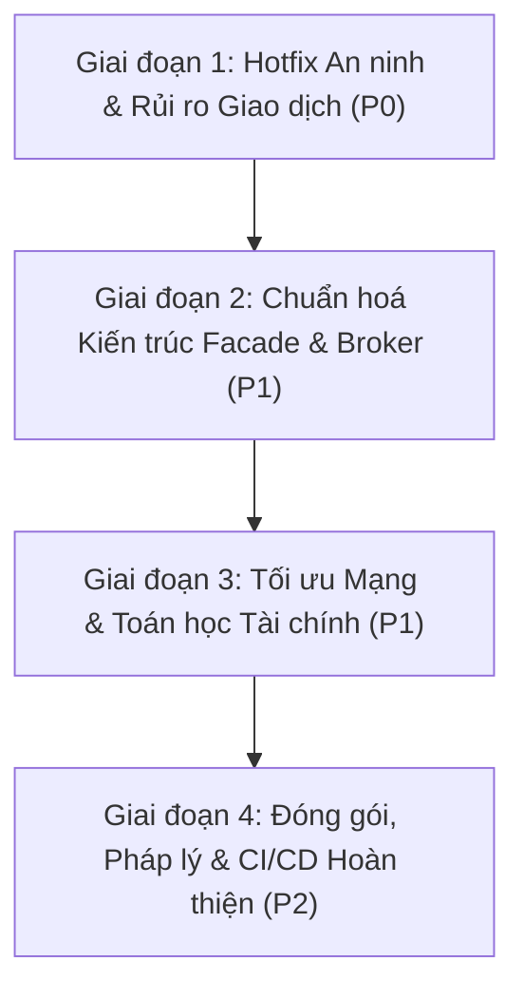

# BÁO CÁO AUDIT TOÀN DIỆN MÃ NGUỒN DỰ ÁN VNBROKER
**Chuẩn tham chiếu:** Bộ tiêu chuẩn Chất lượng Phần mềm Thương mại (Commercial-Grade Software / ISO-IEC 25010)  
**Đối tượng:** Thư viện giao dịch & phân tích tài chính `vnbroker`  
**Phiên bản hiện tại:** 3.1.0 / 3.1.1-dev  
**Ngày lập báo cáo:** 21/09/2026  
**Chuyên gia kiểm định:** AI Principal Software Architect & Security Auditor  
**Kết luận mức độ sẵn sàng:** 🔴 **38 / 100 — KHÔNG ĐẠI DIỆN ĐỦ ĐIỀU KIỆN THƯƠNG MẠI HOÁ (BLOCKED)**

---

## MỤC LỤC
1. [TỔNG QUAN ĐÁNH GIÁ (EXECUTIVE SUMMARY)](#1-tổng-quan-đánh-giá-executive-summary)
2. [MA TRẬN TIÊU CHUẨN THƯƠNG MẠI (COMMERCIAL READINESS MATRIX)](#2-ma-trận-tiêu-chuẩn-thương-mại-commercial-readiness-matrix)
3. [CHI TIẾT CÁC LỖI NGUY HIỂM & KHOẢNG TRỐNG MÃ NGUỒN](#3-chi-tiết-các-lỗi-nguy-hiểm--khoảng-trống-mã-nguồn)
   - [Chương 1: Lỗ hổng Bảo mật & Quản lý Thông tin Xác thực (Security & Secrets)](#chương-1-lỗ-hổng-bảo-mật--quản-lý-thông-tin-xác-thực-security--secrets)
   - [Chương 2: Lỗi Logic Giao dịch & Toàn vẹn Dữ liệu Tài chính (Trading & Financial Math)](#chương-2-lỗi-logic-giao-dịch--toàn-vẹn-dữ-liệu-tài-chính-trading--financial-math)
   - [Chương 3: Bất đồng bộ Kiến trúc & Phân mảnh Mã nguồn (Architecture & Gaps)](#chương-3-bất-đồng-bộ-kiến-trúc--phân-mảnh-mã-nguồn-architecture--gaps)
   - [Chương 4: Độ tin cậy Mạng, Xử lý Lỗi & Khả năng Chịu tải (Reliability & Networking)](#chương-4-độ-tin-cậy-mạng-xử-lý-lỗi--khả-năng-chịu-tải-reliability--networking)
   - [Chương 5: Tiêu chuẩn Đóng gói, Phân phối & Pháp lý (Packaging, Legal & Compliance)](#chương-5-tiêu-chuẩn-đóng-gói-phân-phối--pháp-lý-packaging-legal--compliance)
   - [Chương 6: Vệ sinh Repository & Quản lý Môi trường Dev (Repo Hygiene & Dev Tools)](#chương-6-vệ-sinh-repository--quản-lý-môi-trường-dev-repo-hygiene--dev-tools)
4. [BẢNG TỔNG HỢP DANH MỤC LỖI & MỨC ĐỘ ƯU TIÊN (DEFECT REGISTRY)](#4-bảng-tổng-hợp-danh-mục-lỗi--mức-độ-ưu-tiên-defect-registry)
5. [LỘ TRÌNH CHUYỂN ĐỔI THƯƠNG MẠI HOÁ (COMMERCIAL TRANSFORMATION ROADMAP)](#5-lộ-trình-chuyển-đổi-thương-mại-hoá-commercial-transformation-roadmap)

---

## 1. TỔNG QUAN ĐÁNH GIÁ (EXECUTIVE SUMMARY)

Dự án **vnbroker** được định vị là một bộ công cụ Python phục vụ thu thập dữ liệu thị trường chứng khoán Việt Nam (VCI, KBS, TCBS, DNSE, Quỹ mở Fmarket) và cung cấp giao diện tự động hoá giao dịch trực tiếp với các công ty chứng khoán.

Mặc dù bộ test unit hiện tại đạt tỷ lệ vượt qua cao (505 passed, 5 skipped trên môi trường mock), kết quả kiểm định chuyên sâu mã nguồn (White-box Source Code Audit) chỉ ra rằng dự án hiện **chưa đạt tiêu chuẩn phần mềm thương mại**. Điểm số sẵn sàng thương mại chỉ đạt **38/100**, thuộc mức **BỊ CHẶN (BLOCKED)** do tồn tại các rủi ro hệ thống:

1. **Rò rỉ trực tiếp Live JWT Token và danh tính khách hàng thật** trong thư mục mã nguồn không được gitignore.
2. **Bug nghiêm trọng đảo ngược lệnh Mua thành lệnh Bán** trong module giao dịch DNSE khi người dùng truyền tham số chữ hoa (`BUY`).
3. **Bug Class-level Cache làm tráo đổi dữ liệu tài chính** giữa các mã cổ phiếu khác nhau khi xảy ra fallback.
4. **Sự tồn tại song song của 2 hệ thống Data Facade và 3 hệ thống Brokerage độc lập** nhưng không kết nối được với nhau, khiến nhiều tính năng được quảng bá trong tài liệu thực chất không thể gọi được bằng code.
5. **Chế tạo dữ liệu lịch sử nến OHLC giả mạo** từ dữ liệu tick ngày hiện tại trong adapter TCBS.
6. **Công thức tính chỉ báo kỹ thuật (RSI, ATR) sai lệch** so với chuẩn mực công nghiệp tài chính quốc tế (Wilder's Smoothing).
7. **Mâu thuẫn pháp lý và bản quyền** giữa file `pyproject.toml` và `LICENSE.md`, với điều khoản hiện tại cấm người dùng sử dụng cho mục đích thương mại.

---

## 2. MA TRẬN TIÊU CHUẨN THƯƠNG MẠI (COMMERCIAL READINESS MATRIX)

Đánh giá dựa trên khung tiêu chuẩn ISO/IEC 25010 và các tiêu chí bắt buộc của phần mềm tài chính thương mại:

| Tiêu chí | Trọng số | Điểm | Xếp loại | Nhận xét tổng quát |
|---|:---:|:---:|:---:|---|
| **1. An toàn & Bảo mật (Security & Secrets)** | 20% | **20/100** | 🔴 Nguy hiểm | Lộ token tài khoản thật; dùng proxy công cộng không kiểm soát. |
| **2. Tính đúng đắn Giao dịch & Nghiệp vụ (Trading & Math)** | 25% | **35/100** | 🔴 Nghiêm trọng | Lệnh Mua bị đổi thành Bán; tính sai RSI/ATR; nến lịch sử giả lập. |
| **3. Kiến trúc & Tính nhất quán (Architecture & Consistency)** | 20% | **45/100** | 🟡 Kém | Hai bộ Facade chạy song song; 3 luồng Broker; thiếu method `.broker()`. |
| **4. Độ tin cậy Mạng & Khả năng Chịu lỗi (Reliability)** | 15% | **40/100** | 🟡 Kém | Nhiều request không timeout; retry bắt nhầm `ValueError`; thiếu rate limit. |
| **5. Đóng gói, Phân phối & Pháp lý (Packaging & Legal)** | 10% | **30/100** | 🔴 Không đạt | Thiếu `websockets`; blocking import; License cấm thương mại. |
| **6. Vệ sinh Mã nguồn & CI/CD (Repo Hygiene & Quality)** | 10% | **60/100** | 🟢 Khá | Unit test mock tốt; nhưng tồn tại rác thư mục, thiếu CI lint/mypy tự động. |
| **TỔNG HỢP TOÀN DIỆN** | **100%** | **38/100** | 🔴 **BLOCKED** | **Không đủ điều kiện thương mại hoá.** |

---

## 3. CHI TIẾT CÁC LỖI NGUY HIỂM & KHOẢNG TRỐNG MÃ NGUỒN

---

### Chương 1: Lỗ hổng Bảo mật & Quản lý Thông tin Xác thực (Security & Secrets)

#### 1.1. Rò rỉ Live JWT Token và Thông tin Khách hàng Cá nhân
- **Mức độ nghiêm trọng:** 🔴 **P0 (Critical)**
- **Tệp tin phát hiện:**
  - `docs/tcbs_jwt.txt` (dòng 1)
  - `docs/login_tcbs.py` (dòng 34–38)
- **Bằng chứng mã nguồn:**
  Nội dung file `docs/tcbs_jwt.txt` giải mã từ Base64 JWT Header & Payload:
  ```json
  {
    "iss": "apiopen.tcbs.com.vn",
    "sub": "10000928344",
    "custodyID": "105C836591",
    "tcbsId": "10000928344",
    "sessionID": "85b3ec69-86c9-4820-9555-01af7b0b9155",
    "email": "vietdungiitb@gmail.com",
    "roles": ["customer", "Application/OPEN_API_PILOT"],
    "client_key": "OL0EVtOYLM7LE85/QGXpyvX2hQz5pgFr9EAZMWzGr9O3z2DVtHoKmLWQeWr/49UA"
  }
  ```
- **Nguyên nhân:** Script `docs/login_tcbs.py` thực hiện ghi trực tiếp JWT nhận từ sàn vào thư mục `docs/`. Tệp tin `tcbs_jwt.txt` và các script `login_*.py` hoàn toàn không được liệt kê trong `.gitignore`.
- **Rủi ro vận hành:** Bất kỳ ai clone hoặc có quyền đọc repository đều có thể trích xuất token này để mạo danh khách hàng, truy cập số dư tài khoản, danh mục cổ phiếu và can thiệp giao dịch trên TCBS.
- **Giải pháp xử lý:**
  1. Lập tức thu hồi (Revoke) phiên đăng nhập và đổi mật khẩu/API Key trên hệ thống TCBS.
  2. Xóa bỏ vĩnh viễn file `docs/tcbs_jwt.txt`.
  3. Cập nhật `.gitignore` bổ sung: `docs/*.txt`, `docs/*.jwt`, `docs/login_*.py`, `debug_*.py`.

#### 1.2. Rủi ro An ninh khi Sử dụng Proxy Công cộng Miễn phí
- **Mức độ nghiêm trọng:** 🔴 **P0 (Critical)**
- **Tệp tin phát hiện:** `vnbroker/core/utils/proxy_manager.py` (dòng 55–57)
- **Bằng chứng mã nguồn:**
  ```python
  class ProxyManager:
      PROXYSCRAPE_API = "https://api.proxyscrape.com/v4/free-proxy-list/get"
  ```
- **Phân tích rủi ro thương mại:**
  - `ProxyManager` tự động kết nối và tải danh sách proxy công cộng miễn phí từ Proxyscrape để điều hướng request của người dùng.
  - Các node proxy công cộng trên internet thường bị kiểm soát bởi các bên thứ ba không xác định, tiềm ẩn nguy cơ **Man-in-the-Middle (MITM)**, giải mã SSL, nghe lén truy vấn danh mục đầu tư và chèn dữ liệu sai lệch.
  - Các tổ chức tài chính và doanh nghiệp thương mại nghiêm cấm việc định tuyến dữ liệu qua open proxy.
- **Giải pháp xử lý:**
  - Loại bỏ hoàn toàn module cào proxy công cộng miễn phí khỏi core thư viện.
  - Chỉ hỗ trợ cấu hình proxy tiêu chuẩn doanh nghiệp thông qua biến môi trường chuẩn: `HTTP_PROXY`, `HTTPS_PROXY`, `NO_PROXY` (có hỗ trợ basic authentication).

---

### Chương 2: Lỗi Logic Giao dịch & Toàn vẹn Dữ liệu Tài chính (Trading & Financial Math)

#### 2.1. Đảo ngược Lệnh Mua thành Lệnh Bán trong Module Giao dịch DNSE
- **Mức độ nghiêm trọng:** 🔴 **P0 (Critical - Fatal Bug)**
- **Tệp tin phát hiện:** `vnbroker/connector/dnse/trade.py` (dòng 320)
- **Bằng chứng mã nguồn:**
  ```python
  def place_order(self, sub_account: str, symbol: str, side: str, ...):
      side_code = 'NB' if side == 'buy' else 'NS'
  ```
- **Phân tích lỗi:**
  - Logic so sánh cứng `side == 'buy'`.
  - Nếu người dùng hoặc thuật toán trading truyền: `side="BUY"`, `side="Buy"`, hoặc `side=OrderSide.BUY.value`:
    `"BUY" == "buy"` $\rightarrow$ **`False`**!
  - Kết quả: `side_code` bị gán mặc định thành `'NS'` (**Normal Sell - LỆNH BÁN**)!
- **Hậu quả:** Người dùng gửi lệnh mua cổ phiếu sẽ bị sàn DNSE khớp thành lệnh bán khống hoặc bán cổ phiếu hiện có trong danh mục. Đây là lỗi cấm kỵ tuyệt đối trong phần mềm giao dịch tài chính.
- **Giải pháp xử lý:**
  ```python
  normalized_side = str(side).strip().lower()
  if normalized_side in ("buy", "nb", "b"):
      side_code = "NB"
  elif normalized_side in ("sell", "ns", "s"):
      side_code = "NS"
  else:
      raise ValueError(f"Tham số side không hợp lệ: {side}. Hỗ trợ: 'buy' hoặc 'sell'")
  ```

#### 2.2. Tráo đổi Dữ liệu giữa các Cổ phiếu do Cache Fallback Cấp Class
- **Mức độ nghiêm trọng:** 🔴 **P0 (Critical - Data Contamination)**
- **Tệp tin phát hiện:** `vnbroker/common/data.py` (dòng 204, 237–249)
- **Bằng chứng mã nguồn:**
  ```python
  class BaseComponent:
      _fallback_cache: dict = {}  # Class variable dùng chung cho toàn bộ instance!

      def _load_fallback_provider(self, fb_source: str):
          cache_key = f"fallback_{fb_source}"  # KEY KHÔNG HỀ CHỨA SYMBOL!
          if cache_key in self._fallback_cache:
              return self._fallback_cache[cache_key]
          old_source = self.source
          self.source = fb_source.upper()
          provider = self._load_data_source()
          self.source = old_source
          self._fallback_cache[cache_key] = provider
          return provider
  ```
- **Phân tích lỗi:**
  - Khi người dùng gọi `Company('ACB', source='DNSE').profile()`, do DNSE không có profile nên kích hoạt fallback sang VCI.
  - `_load_fallback_provider('VCI')` khởi tạo `VCICompany('ACB')` và lưu vào cache class: `_fallback_cache["fallback_VCI"] = VCICompany('ACB')`.
  - Tiếp theo, người dùng gọi `Company('VNM', source='DNSE').profile()`. Hàm kiểm tra `cache_key in self._fallback_cache` trả về `True`!
  - Kết quả: Trả về instance `VCICompany('ACB')` đang lưu trong cache. **Dữ liệu của cổ phiếu ACB được trả về cho truy vấn của cổ phiếu VNM!**
- **Giải pháp xử lý:**
  - Chuyển cache từ Class-level sang Instance-level, hoặc bổ sung `symbol` và `component_type` vào `cache_key`:
    ```python
    cache_key = f"{self.__class__.__name__}_{self.symbol}_{fb_source}"
    ```

#### 2.3. Chế tạo Nến Lịch sử OHLC Giả lập từ Intraday Tick của TCBS
- **Mức độ nghiêm trọng:** 🟡 **P1 (High)**
- **Tệp tin phát hiện:** `vnbroker/explorer/tcbs/quote.py` (dòng 433–496)
- **Bằng chứng mã nguồn:**
  ```python
  while current_date <= end_date:
      date_str = current_date.strftime("%Y-%m-%d")
      ...
      url = f"{self.base_url}{NYX_PATH}/intraday/{self.symbol}/his/paging"
      response = client.send_request(url=url, params={'page': page, 'size': 100, ...})
      ...
      # Gán nhãn ngày nhân tạo cho dữ liệu tick ngày hôm nay:
      record["_date"] = current_date.date()
      ...
      current_date += timedelta(days=1)
  ```
- **Phân tích lỗi:**
  - TCBS iFlash OpenAPI không cung cấp endpoint nến lịch sử OHLC (`/stock-insight/v2/stock/bars` của hệ thống cũ đã bị đóng).
  - Hàm `_compute_ohlc_from_intraday` cố tình mô phỏng bằng cách lặp qua từng ngày trong khoảng `[start, end]` và gọi API tick intraday.
  - Tuy nhiên, API intraday của TCBS **chỉ chứa dữ liệu giao dịch của ngày hiện tại**.
  - Code tự động lấy tick của ngày hôm nay và gán nhãn thành ngày trong quá khứ (`current_date.date()`).
- **Hậu quả:** Nếu người dùng yêu cầu dữ liệu lịch sử năm 2023, hàm sẽ bắn 365 chuỗi request lên máy chủ TCBS, lấy cùng một tập dữ liệu tick của ngày hôm nay và gán nhãn thành 365 ngày của năm 2023! Đây là dữ liệu giả mạo nguy hiểm đối với các mô hình backtest.
- **Giải pháp xử lý:**
  - Không giả lập dữ liệu lịch sử bằng intraday.
  - Với nguồn TCBS, phương thức `quote.history()` phải ném ra `NotImplementedError` có hướng dẫn rõ ràng: *"TCBS iFlash OpenAPI hiện chưa mở endpoint OHLC lịch sử. Vui lòng sử dụng source='VCI' hoặc source='KBS' để lấy nến lịch sử."*

#### 2.4. Sai lệch Công thức Chỉ báo Kỹ thuật Chuẩn Quốc tế
- **Mức độ nghiêm trọng:** 🟡 **P1 (High)**
- **Tệp tin phát hiện:** `vnbroker/analytics/indicators.py` (dòng 76–83, 172)
- **Chi tiết sai lệch:**
  1. **RSI không tuân theo Wilder's Smoothing:**
     - Code hiện tại:
       ```python
       avg_gain = gain.rolling(window=window, min_periods=1).mean()
       avg_loss = loss.rolling(window=window, min_periods=1).mean()
       ```
     - Đây là Simple Moving Average (SMA). Theo đúng chuẩn kỹ thuật của J. Welles Wilder (áp dụng trên Bloomberg, TradingView, TCBS, SSI), RSI bắt buộc phải tính bằng Exponential Moving Average theo trọng số Wilder ($\alpha = 1 / \text{window}$):
       ```python
       avg_gain = gain.ewm(alpha=1/window, min_periods=window, adjust=False).mean()
       avg_loss = loss.ewm(alpha=1/window, min_periods=window, adjust=False).mean()
       ```
  2. **Bug hiển thị RSI = 100 khi thị trường đi ngang:**
     - Khi cổ phiếu đóng băng thanh khoản hoặc giá không đổi liên tục, cả `gain` và `loss` đều bằng 0. `rs` là `NaN`. Dòng 83 xử lý:
       ```python
       rsi_values = rsi_values.fillna(100)
       ```
     - Điều này khiến RSI của cổ phiếu đi ngang bị gán thành **100 (vùng cực đỉnh quá mua)** thay vì **50 (vùng trung tính)**!
  3. **ATR tính sai công thức:** Dòng 172 tính True Range bằng `rolling(window).mean()` (SMA) thay vì phương pháp làm mượt số mũ của Wilder.

---

### Chương 3: Bất đồng bộ Kiến trúc & Phân mảnh Mã nguồn (Architecture & Gaps)

#### 3.1. Sự Tồn tại Song song của 2 Hệ thống Data Facade
- **Mức độ nghiêm trọng:** 🟡 **P1 (High)**
- **Thực trạng phân mảnh:**
  - **Hệ thống Facade Legacy:** Nằm tại `vnbroker/common/data.py`, gồm các class `Quote`, `Company`, `Finance`, `Trading` kế thừa từ `BaseComponent`. Sử dụng chuỗi `if-else` cứng để import provider, chứa bug cache fallback.
  - **Hệ thống Facade Hiện đại:** Nằm tại `vnbroker/api/` (`quote.py`, `company.py`, v.v.), kế thừa từ `BaseAdapter`, tích hợp cơ chế `dynamic_method`, `ProviderRegistry` và bộ định tuyến nguồn động `source_router.py` (AUTO source failover).
- **Hậu quả:** Class chính `Vnbroker` trong `vnbroker/common/client.py` khởi tạo `StockComponents`, và `StockComponents` lại gọi trực tiếp vào hệ thống legacy `vnbroker.common.data`! Toàn bộ tính năng ưu việt của hệ thống mới `vnbroker.api` (được mô tả chi tiết trong `CLAUDE.md`) thực chất **bị bỏ quên và không hề được thực thi**.

#### 3.2. Ba Hệ sinh thái Brokerage Xung đột, Thiếu Kết nối với Client
- **Mức độ nghiêm trọng:** 🟡 **P1 (High)**
- **Thực trạng phân mảnh:**
  1. `vnbroker.broker`: Thiết kế theo hướng TCBS OpenAPI. Sử dụng `BaseBrokerClient`, `BrokerSession`, `BrokerRegistry`. Dữ liệu trả về dạng thô `dict[str, Any]`.
     - *Khiếm khuyết:* Class `TCBSBrokerClient` **không kế thừa** `BaseBrokerClient`.
     - *Khiếm khuyết:* `BrokerRegistry` **không đăng ký bất kỳ broker nào** trong mã nguồn sản phẩm (chỉ có trong mock test).
  2. `vnbroker.brokerage`: Thiết kế theo hướng Private API HMAC. Định nghĩa cấu trúc dữ liệu strongly-typed hiện đại (`OrderRequest`, `Balance`, `Position`).
     - *Khiếm khuyết:* Tệp `vnbroker/brokerage/dnse/client.py` là một **file rỗng 0 bytes** nằm trong git working tree.
  3. `vnbroker.connector.dnse`: Module độc lập triển khai riêng cho DNSE với `Trade` và `DNSEClient`.
  4. **Class chính `Vnbroker` thiếu hoàn toàn method `.broker()`:**
     - Trong `CLAUDE.md` hướng dẫn người dùng:
       ```python
       vn = Vnbroker()
       client = vn.broker(provider="tcbs", api_key="...")
       ```
     - Nhưng trong mã nguồn `vnbroker/common/client.py`, `Vnbroker` chỉ có các method: `stock()`, `fx()`, `crypto()`, `world_index()`, `fund()`. Gọi `vn.broker(...)` sẽ ném ra ngoại lệ `AttributeError` ngay lập tức.

#### 3.3. Module Bị Xóa Gây Lỗi Lazy Import
- **Mức độ nghiêm trọng:** 🟡 **P1 (High)**
- **Tệp tin phát hiện:** `vnbroker/__init__.py` (dòng 43)
- **Bằng chứng mã nguồn:**
  ```python
  from .explorer import vci, tcbs, msn, kbs, rss_cafef, rss_vneconomy
  ```
- **Lỗi:** Module `msn` đã bị xóa bỏ hoàn toàn trong đợt tái cấu trúc v3.1.0. Khi hàm `_ensure_explorer_modules_loaded()` được kích hoạt, dòng lệnh này phát sinh lỗi `ImportError: cannot import name 'msn'`. Mặc dù có khối `try...except`, nhưng việc dừng giữa chừng khiến các module phía sau (`kbs`, `rss_cafef`, `rss_vneconomy`, `dnse`) không được nạp theo chuỗi lazy load.

#### 3.4. Bắt Buộc API Key Vô Lý cho Module Trống của DNSE
- **Mức độ nghiêm trọng:** 🟢 **P2 (Medium)**
- **Tệp tin phát hiện:** `vnbroker/explorer/dnse/company.py` (dòng 168–176), `news.py` (dòng 68–74), `finance.py`.
- **Lỗi:** DNSE không hỗ trợ dữ liệu doanh nghiệp và tin tức, các module này chỉ trả về DataFrame rỗng. Tuy nhiên, hàm khởi tạo lại kiểm tra và ném lỗi `ValueError: DNSE cần api_key và api_secret`. Việc ép buộc người dùng phải cung cấp API key để nhận về bảng rỗng là một lỗi thiết kế trải nghiệm người dùng (UX/DX).

---

### Chương 4: Độ tin cậy Mạng, Xử lý Lỗi & Khả năng Chịu tải (Reliability & Networking)

#### 4.1. Hàng loạt Request HTTP Không Có Timeout
- **Mức độ nghiêm trọng:** 🟡 **P1 (High)**
- **Tệp tin phát hiện:**
  - `vnbroker/connector/dnse/trade.py`: các phương thức `login()` (dòng 64), `sub_accounts()` (dòng 104), `account_balance()` (dòng 125), `get_trading_token()` (dòng 168), `trade_capacities()` (dòng 285), `place_order()` (dòng 340), `cancel_order()` (dòng 441), `deposit()` (dòng 621), `withdraw()` (dòng 665).
  - `vnbroker/bot/notify.py`: `_telegram_message()` (dòng 399), `_lark_message()` (dòng 534), `_lark_file()` (dòng 582).
- **Hậu quả:** Thư viện `requests` của Python mặc định không áp dụng timeout nếu không được chỉ định rõ ràng. Nếu máy chủ của công ty chứng khoán hoặc cổng webhook gặp sự cố ngắt kết nối âm thầm (TCP drop/SYN freeze), toàn bộ tiến trình Python của người dùng hoặc bot tự động sẽ **bị treo vô thời hạn (infinite hang)** mà không bao giờ giải phóng tài nguyên.

#### 4.2. Tenacity Retry Nuốt Lỗi Của Người Dùng
- **Mức độ nghiêm trọng:** 🟡 **P1 (High)**
- **Tệp tin phát hiện:** `vnbroker/common/data.py` (dòng 415–422) và `vnbroker/base.py` (dòng 182–192)
- **Bằng chứng mã nguồn:**
  ```python
  @retry(
      stop=stop_after_attempt(Config.RETRIES),
      wait=wait_exponential(multiplier=1, min=2, max=10)
  )
  def history(self, symbol: Optional[str] = None, **kwargs):
      ...
  ```
- **Lỗi:** Không định nghĩa `retry_if_exception_type(...)` và thiếu `reraise=True`.
- **Hậu quả:** Khi người dùng truyền sai tham số (ví dụ thiếu ngày tháng hợp lệ sinh ra `ValueError`), cơ chế retry vẫn bắt lấy lỗi, chờ 2 giây, thử lại, chờ 4 giây, thử lại, chờ 8 giây, rồi ném ra ngoại lệ `tenacity.RetryError` bao bọc bên ngoài. Lỗi nhập liệu đơn giản bị kéo dài thành 15 giây và người dùng không nhìn thấy thông báo lỗi thực sự.

#### 4.3. Rate Limiter Không Được Áp Dụng cho Client Đồng Bộ
- **Mức độ nghiêm trọng:** 🟡 **P1 (High)**
- **Tệp tin phát hiện:** `vnbroker/core/utils/client.py`
- **Phân tích:** Cấu hình `Config.RATE_LIMIT_RPM = 300` chỉ được gắn vào client bất đồng bộ `vnbroker/core/utils/async_client.py`. Toàn bộ các lệnh gọi hàm đồng bộ thông qua `send_request()` (chiếm hơn 90% thư viện) không có bất kỳ bộ đếm tốc độ nào. Nếu người dùng gọi lấy dữ liệu danh mục 50 mã trong vòng lặp `for`, các máy chủ VCI hoặc KBS sẽ lập tức chặn IP với mã lỗi HTTP 429 hoặc khóa tường lửa.

---

### Chương 5: Tiêu chuẩn Đóng gói, Phân phối & Pháp lý (Packaging, Legal & Compliance)

#### 5.1. Thiếu Dependencies Bắt Buộc trong `pyproject.toml`
- **Mức độ nghiêm trọng:** 🟡 **P1 (High)**
- **Tệp tin phát hiện:** `pyproject.toml` (dòng 34–48) và `requirements.txt`
- **Chi tiết:**
  - Module WebSocket của TCBS (`vnbroker/explorer/tcbs/websocket.py`) và DNSE (`vnbroker/connector/dnse/websocket.py`) sử dụng thư viện `websockets`.
  - Tuy nhiên, trong `dependencies` của `pyproject.toml` và `requirements.txt` **hoàn toàn không khai báo `websockets`**.
  - Người dùng cài đặt `pip install vnbroker` từ môi trường sạch sẽ gặp lỗi `ModuleNotFoundError: No module named 'websockets'` ngay khi khởi tạo streaming.
  - Tệp `pyproject.toml` dòng 8 có lỗi encoding ký tự: `"automation ? built to make..."` (dấu hỏi chấm thay cho gạch ngang).

#### 5.2. Chặn Luồng Mạng Đồng Bộ Khi `import vnbroker`
- **Mức độ nghiêm trọng:** 🟢 **P2 (Medium)**
- **Tệp tin phát hiện:** `vnbroker/__init__.py` (dòng 68–73) và `vnbroker/core/utils/upgrade.py` (dòng 189–206)
- **Bằng chứng mã nguồn:**
  ```python
  if not os.getenv("PYTEST_RUNNING"):
      try:
          from vnbroker.core.utils.upgrade import update_notice
          update_notice(verbose=False)
      except Exception:
          pass
  ```
- **Phân tích rủi ro thương mại:**
  - Mỗi khi bất kỳ file nào gọi `import vnbroker`, hàm `update_notice()` sẽ gửi một HTTP GET đồng bộ tới `https://api.github.com/repos/vietdungiitb/vnbroker/releases/latest` với timeout 5 giây.
  - GitHub API áp dụng rate-limit nghiêm ngặt (tối đa 60 request/giờ cho IP công cộng). Khi chạy trên hệ thống CI/CD hoặc văn phòng dùng chung mạng, lệnh import sẽ liên tục bị lỗi rate limit.
  - Trong môi trường Docker hoặc máy chủ không có kết nối internet, lệnh import bị đơ 5 giây trước khi vào được code chính.
  - Tiêu chuẩn thư viện thương mại: Không bao giờ thực hiện network call đồng bộ khi import module. Kiểm tra phiên bản phải chạy background thread không chặn, hoặc lưu cache local 24h, hoặc chỉ chạy khi người dùng yêu cầu qua CLI.

#### 5.3. Mâu thuẫn Pháp lý Bản quyền & Điều khoản Cấm Thương Mại
- **Mức độ nghiêm trọng:** 🟡 **P1 (High - Legal Blocker)**
- **Tệp tin phát hiện:** `pyproject.toml` (dòng 10–13) và `LICENSE.md` (dòng 3, 13–20, 37)
- **Mâu thuẫn:**
  1. Trong `pyproject.toml`: Author ghi `Thinh Vu` (`support@vnstocks.com`), License ghi `Custom: Personal, research, non-commercial`.
  2. Trong `LICENSE.md`: Copyright ghi `Phạm Việt Dũng` (`vietdungiitb@gmail.com`), nhưng mục 6 liên hệ cấp phép lại ghi `support@vnstocks.com`.
  3. **Rào cản pháp lý thương mại:** Mục 2 của `LICENSE.md` quy định rõ:
     > *"Bạn không được dùng phần mềm cho: mục đích thương mại; triển khai nội bộ cho tổ chức có thu phí, doanh thu hoặc giá trị dịch vụ; tích hợp vào sản phẩm hoặc dịch vụ trả phí..."*
  - Nếu dự án dự kiến được phát triển thành sản phẩm thương mại, việc giữ giấy phép cấm thương mại và thông tin tác giả mâu thuẫn là một rủi ro pháp lý nghiêm trọng.

#### 5.4. Shadowing Exception Chuẩn của Python
- **Mức độ nghiêm trọng:** 🟢 **P2 (Medium)**
- **Tệp tin phát hiện:** `vnbroker/core/exceptions.py` (dòng 341)
- **Bằng chứng mã nguồn:**
  ```python
  class DeprecationWarning(UserWarning):
      """Warning for deprecated features."""
      pass
  ```
- **Lỗi:** Định nghĩa class trùng tên và kế thừa từ `UserWarning` thay vì `Warning`, ghi đè lên class có sẵn của ngôn ngữ Python (`builtins.DeprecationWarning`). Điều này làm sai lệch cơ chế lọc cảnh báo của trình thông dịch Python.

---

### Chương 6: Vệ sinh Repository & Quản lý Môi trường Dev (Repo Hygiene & Dev Tools)

#### 6.1. Tồn tại Rác Thư mục và File Thừa trong Codebase
- **Mức độ nghiêm trọng:** 🟢 **P2 (Medium)**
- Thư mục rỗng mang tên `-p` ở thư mục gốc (sinh ra do gõ lệnh `mkdir -p` trên shell Windows).
- Các script benchmark và kiểm thử ad-hoc nằm lộn xộn ở root: `test_acb_benchmark.py`, `test_tcbs_direct.py`.
- Thư mục `docs/` chứa hơn 80 file báo cáo sprint cũ, nghiên cứu phái sinh, dump token và endpoint từ các phiên bản trước không được phân loại hoặc chuyển vào thư mục lưu trữ (`archive/`).

#### 6.2. Thiếu Công cụ Kiểm soát Chất lượng trong Cấu hình Dự án
- **Mức độ nghiêm trọng:** 🟢 **P2 (Medium)**
- `CLAUDE.md` yêu cầu nghiêm ngặt: `mypy vnbroker --strict`, `ruff check vnbroker`, `ruff format vnbroker`.
- Tuy nhiên trong môi trường `.venv` và file `pyproject.toml`:
  - `ruff` và `flake8` chưa được cấu hình các rule cụ thể trong `pyproject.toml`.
  - Thiếu pre-commit hook để ngăn chặn việc commit các file secret như `tcbs_jwt.txt` hoặc `.env`.

---

## 4. BẢNG TỔNG HỢP DANH MỤC LỖI & MỨC ĐỘ ƯU TIÊN (DEFECT REGISTRY)

| Mã Defect | Phân loại | Mức độ | File & Dòng | Tóm tắt Vấn đề | Tác động Vận hành |
|---|---|:---:|---|---|---|
| **SEC-01** | Bảo mật | 🔴 **P0** | `docs/tcbs_jwt.txt:1` | Lộ live JWT token thật của khách hàng TCBS | Mất an toàn tài khoản giao dịch |
| **SEC-02** | Bảo mật | 🔴 **P0** | `docs/login_tcbs.py:35` | Script tự động ghi JWT token ra file không gitignore | Rò rỉ token khi chạy test |
| **SEC-03** | Bảo mật | 🔴 **P0** | `core/utils/proxy_manager.py:55` | Tự động tải và định tuyến qua free proxy công cộng | Nguy cơ tấn công Man-in-the-Middle |
| **TRD-01** | Giao dịch | 🔴 **P0** | `connector/dnse/trade.py:320` | `side == 'buy'` khiến lệnh `BUY` bị chuyển thành BÁN | Gây tổn thất tài chính trực tiếp |
| **DAT-01** | Dữ liệu | 🔴 **P0** | `common/data.py:239` | `_fallback_cache` cấp class không chứa symbol | Dữ liệu mã này bị tráo sang mã khác |
| **ARC-01** | Kiến trúc | 🔴 **P0** | `common/client.py` | `Vnbroker` thiếu method `.broker()` | Người dùng gọi `vn.broker()` bị crash |
| **DAT-02** | Dữ liệu | 🟡 **P1** | `explorer/tcbs/quote.py:433` | Lặp lại tick hôm nay để chế tạo 365 nến lịch sử | Dữ liệu nến quá khứ bị giả mạo |
| **IND-01** | Toán tài chính | 🟡 **P1** | `analytics/indicators.py:76` | Tính RSI/ATR bằng SMA thay vì Wilder's EWM; bug giá đi ngang | Chỉ báo sai lệch hoàn toàn so với bảng giá |
| **ARC-02** | Kiến trúc | 🟡 **P1** | `vnbroker/__init__.py:43` | Lazy import gọi module `msn` đã bị xóa | Sinh warning và đứt chuỗi nạp provider |
| **ARC-03** | Kiến trúc | 🟡 **P1** | `brokerage/dnse/client.py:1` | File rỗng 0 bytes, kiến trúc broker bị phân mảnh 3 nơi | Bất đồng bộ luồng phát triển |
| **PKG-01** | Đóng gói | 🟡 **P1** | `pyproject.toml:34` | Thiếu dependency `websockets`, lỗi encoding description | Crash khi dùng WebSocket streaming |
| **NET-01** | Mạng | 🟡 **P1** | `connector/dnse/trade.py:64` | Hàng loạt request HTTP POST/DELETE thiếu timeout | Ứng dụng/bot bị treo vĩnh viễn |
| **NET-02** | Mạng | 🟡 **P1** | `common/data.py:415` | `@retry` bắt nhầm `ValueError` và nuốt lỗi gốc | Kéo dài thời gian báo lỗi, che giấu bug |
| **LIC-01** | Pháp lý | 🟡 **P1** | `LICENSE.md:13` | Giấy phép cấm dùng thương mại, mâu thuẫn tác giả | Rủi ro pháp lý khi thương mại hoá |
| **NET-03** | Mạng | 🟢 **P2** | `vnbroker/__init__.py:68` | Blocking HTTP request kiểm tra version khi import | Giảm tốc độ startup, dính rate limit GitHub |
| **ARC-04** | Trải nghiệm | 🟢 **P2** | `explorer/dnse/company.py:172` | Bắt buộc API key cho các provider trả về bảng rỗng | Trải nghiệm người dùng kém |
| **EXC-01** | Tiêu chuẩn | 🟢 **P2** | `core/exceptions.py:341` | Shadowing exception chuẩn `DeprecationWarning` | Phá vỡ chuẩn xử lý warning của Python |
| **CLN-01** | Vệ sinh | 🟢 **P2** | Thư mục root & `docs/` | Thư mục `-p`, test script ở root, docs không archive | Ô nhiễm repository |

---

## 5. LỘ TRÌNH CHUYỂN ĐỔI THƯƠNG MẠI HOÁ (COMMERCIAL TRANSFORMATION ROADMAP)

Để đưa dự án `vnbroker` từ trạng thái hiện tại lên một **sản phẩm thương mại chuyên nghiệp, ổn định và bảo mật cao**, lộ trình triển khai gồm 4 giai đoạn được khuyến nghị:



---

### Giai đoạn 1: Hotfix Khẩn cấp về An ninh & Giao dịch (Ưu tiên thực hiện ngay)
1. **Xử lý rò rỉ bảo mật:**
   - Xóa bỏ ngay `docs/tcbs_jwt.txt`.
   - Thu hồi token và session TCBS đang hoạt động.
   - Thêm quy tắc vào `.gitignore`:
     ```gitignore
     docs/*.txt
     docs/*.jwt
     docs/login_*.py
     debug_*.py
     tmp/
     ```
   - Vô hiệu hóa tính năng cào free proxy không an toàn trong `proxy_manager.py`.
2. **Vá lỗi đảo lệnh giao dịch:**
   - Sửa logic kiểm tra `side` trong `vnbroker/connector/dnse/trade.py` dòng 320:
     ```python
     side_code = 'NB' if str(side).strip().lower() in ('buy', 'nb') else 'NS'
     ```
3. **Vá lỗi Cache tráo đổi cổ phiếu:**
   - Sửa `_fallback_cache` trong `vnbroker/common/data.py` gắn liền với `self.symbol` và chuyển thành biến cục bộ instance.
4. **Bổ sung dependency đóng gói:**
   - Thêm `websockets>=11.0` vào `dependencies` của `pyproject.toml` và `requirements.txt`.
   - Sửa lỗi ký tự encoding trong `pyproject.toml`.

---

### Giai đoạn 2: Chuẩn hoá Kiến trúc & Hợp nhất Giao diện (Architecture Harmonization)
1. **Thống nhất luồng Broker:**
   - Chọn chuẩn Dataclass strongly-typed của `vnbroker.brokerage` (`OrderRequest`, `OrderResponse`, `Balance`, `Position`) làm chuẩn duy nhất cho người dùng thương mại.
   - Xóa bỏ file rỗng `vnbroker/brokerage/dnse/client.py`, chuyển đổi `vnbroker/connector/dnse/trade.py` tương thích với interface `BrokerageBase`.
   - Bổ sung method `broker()` vào class chính `Vnbroker` trong `vnbroker/common/client.py`:
     ```python
     def broker(self, provider: str = "tcbs", **kwargs):
         from vnbroker.broker.registry import BrokerRegistry
         return BrokerRegistry.create(provider, **kwargs)
     ```
2. **Hợp nhất Data Access Facade:**
   - Đưa `Vnbroker.stock()` chuyển sang sử dụng trực tiếp hệ thống `vnbroker.api` (dựa trên `BaseAdapter`, `ProviderRegistry` và `source_router`).
   - Xóa bỏ hoàn toàn class `msn` khỏi `vnbroker/__init__.py` để tránh lỗi lazy load.
   - Kết nối module Screener vào `StockComponents`.

---

### Giai đoạn 3: Độ tin cậy Mạng & Chuẩn hoá Chỉ báo Tài chính
1. **Audit toàn diện HTTP Timeout:**
   - Bổ sung tham số `timeout=Config.REQUEST_TIMEOUT` (mặc định 30s) vào toàn bộ các lệnh gọi `requests.get()`, `requests.post()`, `requests.delete()`.
2. **Chuẩn hoá cơ chế Retry:**
   - Điều chỉnh decorator `@retry` trong `common/data.py` và `base.py`:
     ```python
     from tenacity import retry_if_exception_type
     import requests

     @retry(
         retry=retry_if_exception_type((requests.exceptions.RequestException, ConnectionError, TimeoutError)),
         stop=stop_after_attempt(Config.RETRIES),
         wait=wait_exponential(multiplier=1, min=2, max=10),
         reraise=True
     )
     ```
3. **Viết lại Chỉ báo Kỹ thuật Chuẩn Quốc tế:**
   - Viết lại `rsi()` và `atr()` trong `vnbroker/analytics/indicators.py` sử dụng công thức Wilder's Smoothing (`ewm(alpha=1/window, adjust=False)`).
   - Xử lý trường hợp chuỗi giá đi ngang trả về RSI = 50.
   - Thêm validation kiểm tra DataFrame rỗng và cột bắt buộc trong `compute_all_indicators()`.
4. **Áp dụng Rate Limiting Toàn cục:**
   - Tích hợp bộ đếm tốc độ (Token Bucket Rate Limiter) vào hàm `send_request()` đồng bộ trong `core/utils/client.py`.

---

### Giai đoạn 4: Hoàn thiện Pháp lý, Đóng gói & Quy chuẩn Môi trường Dev
1. **Soạn thảo Giấy phép Thương mại (Commercial Licensing):**
   - Cập nhật `LICENSE.md` phù hợp với mô hình kinh doanh (Commercial Proprietary License / Dual-License).
   - Đồng nhất thông tin tác giả và kênh hỗ trợ giữa `pyproject.toml` và `LICENSE.md`.
2. **Loại bỏ Blocking Import Call:**
   - Chuyển `update_notice()` sang chạy bằng background daemon thread hoặc chỉ kiểm tra khi người dùng chủ động gọi hàm kiểm tra bản nâng cấp.
3. **Dọn dẹp Kho Mã nguồn:**
   - Xóa thư mục `-p`.
   - Di chuyển các file test ở thư mục gốc (`test_acb_benchmark.py`, `test_tcbs_direct.py`) vào thư mục `tests/benchmarks/` và `tests/manual/`.
   - Gom các file kế hoạch cũ trong `docs/` vào thư mục `docs/archive/`.
4. **Thiết lập CI/CD Quality Gate:**
   - Tạo workflow GitHub Actions tự động thực hiện: `ruff check`, `mypy vnbroker --strict`, `pytest tests/unit` trên mỗi commit và pull request.

---
*Báo cáo được hoàn thành và lưu trữ chính thức tại thư mục tài liệu dự án.*
